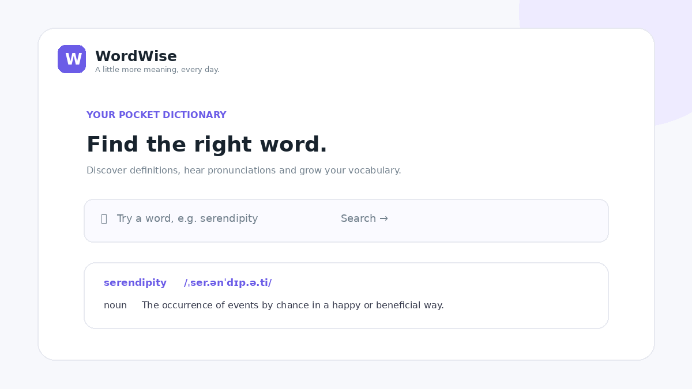

# WordWise — Dictionary App

A responsive, frontend-only dictionary built with **HTML, CSS and vanilla JavaScript**.



## Features
- Search English words using the Free Dictionary API.
- Display phonetic spelling, parts of speech and definitions.
- Show example sentences when available.
- Play pronunciation audio when the API provides an audio file.
- Responsive layout for desktop and mobile.

## Project structure
```text
dictionary-app/
├── index.html
├── README.md
├── screenshot.png
├── css/
│   └── style.css
└── js/
    └── script.js
```

## Run locally
1. Download or clone this folder.
2. Open `index.html` in a browser. For best results, use VS Code Live Server.
3. Search for a word while connected to the internet.

## API
`https://api.dictionaryapi.dev/api/v2/entries/en/<word>`

No backend or API key is required. Search results depend on the public API being available and on the word existing in its database.

## Built with
HTML5 · CSS3 · JavaScript · Fetch API · Free Dictionary API

## Author

**Tejaswini N**
GitHub: https://github.com/tejaswini-n-cse
